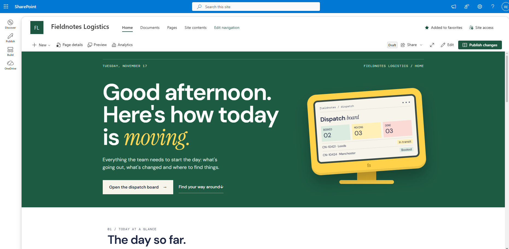
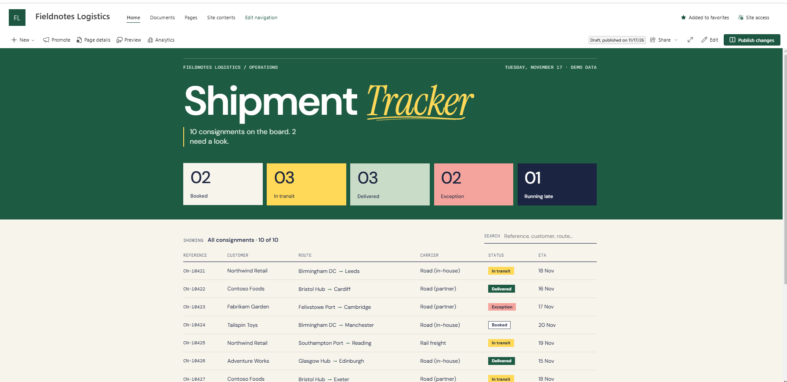
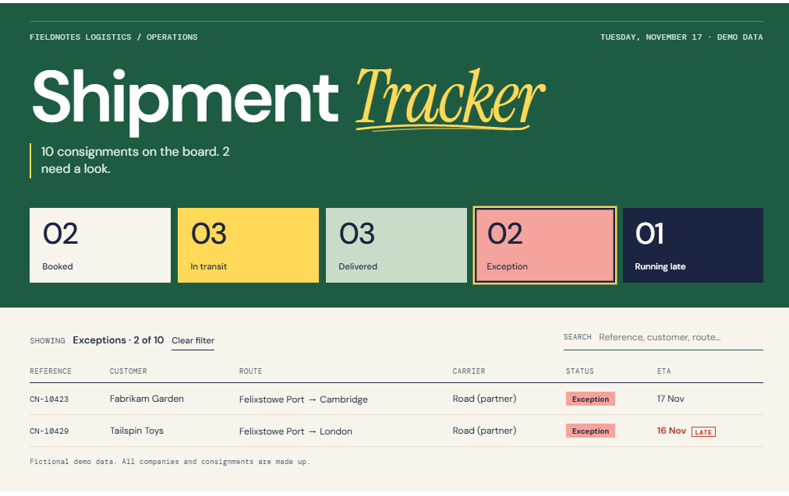
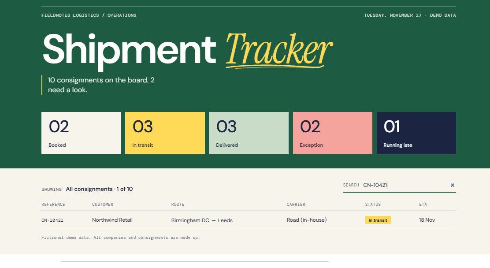
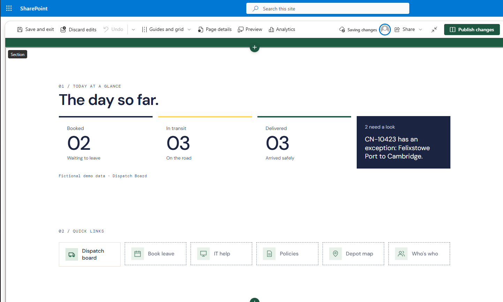
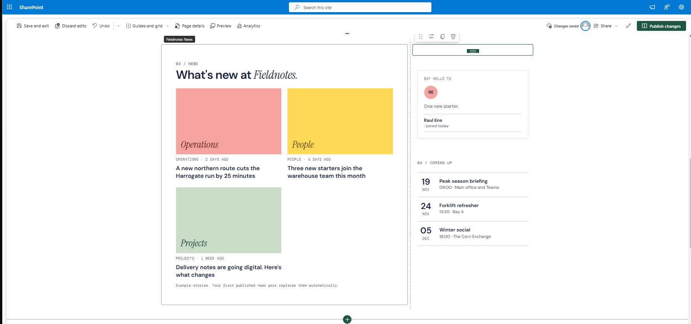
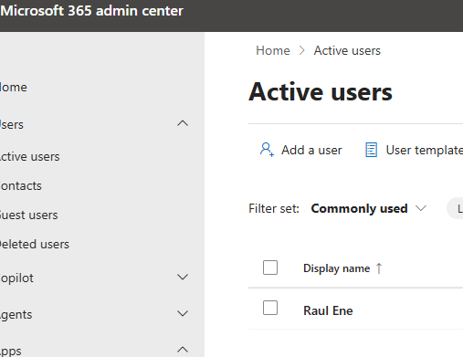
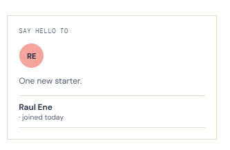
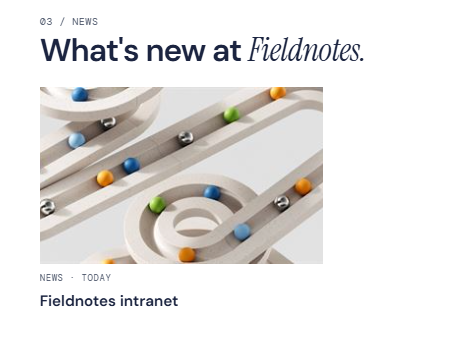
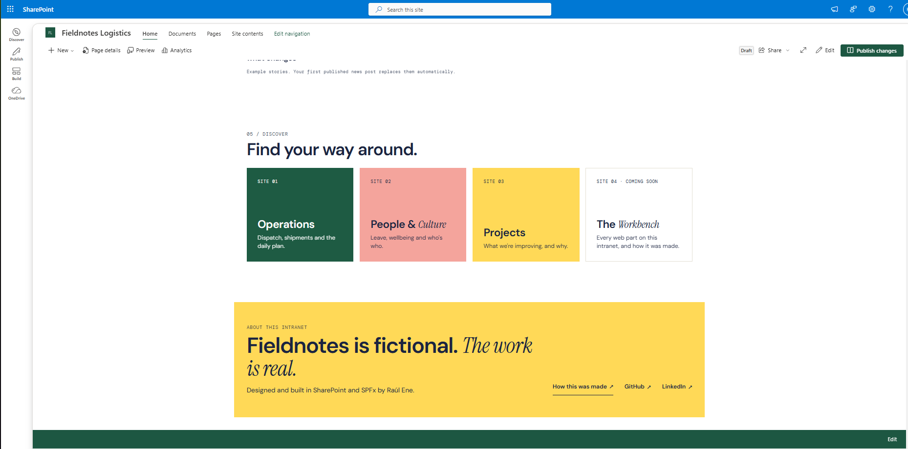

# SPFx Logistics Hub

The intranet landing page for **Fieldnotes Logistics**, a fictional haulage and warehousing company, built as a set of SharePoint Framework (SPFx) web parts. It covers a live dispatch board, an Excel importer that turns the weekly shipments spreadsheet into SharePoint list data, news that updates itself, and new starters picked up from Entra ID.


[](https://github.com/raulene-git/spfx-logistics-hub/actions/workflows/ci.yml)



> **Status:** the landing page is deployed to a Microsoft 365 test tenant. All 10 web parts are built, packaged as one solution and covered by 40 unit tests.

## On the page

### Dispatch Board



| Filter by tile | Search |
| --- | --- |
|  |  |

### Today at a glance and quick links



### News, new starters and dates



### Self-updating, live in the tenant

| A user created in Entra ID… | …appears in Say Hello by itself | A published news post appears in News |
| --- | --- | --- |
|  |  |  |

### Find your way around



## Web parts

All of them sit together in one **Fieldnotes** group in the SharePoint toolbox, each with its own branded icon.

| Web part | What it does |
| --- | --- |
| **Fieldnotes Hero** | Full-width welcome banner. Greets by time of day, has a configurable main button, and a "Find your way around" link that jumps to any section on the page, picked from a list the web part builds by scanning the page. |
| **Dispatch Board** | The highlight of the page: every consignment with status tiles that double as filters, a running-late count, search, and status chips. Reads a SharePoint list or built-in demo data. |
| **Board Snapshot** | A second layout of the same web part: today's counts plus a card naming the consignment that needs attention, linking to the full board. |
| **Shipment Importer** | Upload the weekly Excel or CSV sheet, check it, and add or update rows in the Shipments list (see below). |
| **Fieldnotes News** | The latest news posts with thumbnail, topic and "2 days ago". Publishing a normal SharePoint news post makes it appear here, with no setup. |
| **Coming Up** | Upcoming dates in a big-day-number layout. Authors choose how many to show; past events drop off by themselves. |
| **Say Hello** | Welcomes new starters. Switched to Entra ID, it reads accounts created in the last 7–90 days from Microsoft Graph, with their department, so a new user created in Entra appears on the page by themselves. |
| **Discover** | Colour cards for the intranet's sites, either picked by hand or listed automatically from the sites joined to the hub. |
| **Fieldnotes Quick Links** | Icon tiles for everyday destinations, 1–12 of them. |
| **Callout Band** | A full-width coloured statement band with up to three links. |

### Shipment Importer: from spreadsheet to list

Most logistics teams live in Excel, so the importer meets them there:

1. **Drop in** an `.xlsx` or `.csv` file (or download a template).
2. **Check:** columns are matched automatically even with everyday headers ("Consignment Ref", "Haulier", "Due Date"), everyday statuses are understood ("out for delivery" counts as *In transit*), and each row is checked with a plain reason when something is wrong, such as a missing customer, an unknown status, a duplicate reference or a date that isn't a date.
3. **Import:** rows are added to the list, or updated when the reference already exists, with a progress bar and a result showing added, updated and failed.

`demo-data/shipments-weekly.xlsx` is a deliberately messy sample with three broken rows to try it on.

## How it's built

```
src/
├─ common/                        Shared by every web part
│  ├─ FieldnotesWebPart.ts        Base class: fonts, React root, edit mode, dispose
│  ├─ _brand.scss                 Colour, type and spacing tokens
│  ├─ propertyPane.ts             Header, link and anchor fields, colour options
│  ├─ links.ts                    Safe-link checks, slugs, "3 days ago"
│  └─ components/                 Section wrapper, placeholders, icon set
└─ webparts/
   ├─ fieldnotesHero/             Hero + decorative monitor
   ├─ shipmentTracker/            Dispatch Board and Board Snapshot
   │  ├─ services/                IShipmentService: demo data or SharePoint REST
   │  └─ utils/shipmentUtils.ts   Filtering, counts, late logic
   ├─ shipmentImporter/
   │  ├─ utils/spreadsheet.ts     Dependency-free .xlsx and CSV reader
   │  ├─ utils/mapping.ts         Column matching, status and date parsing, row checks
   │  └─ services/ImportService.ts Add or update by reference
   ├─ news/services/NewsService.ts Published news posts from Site Pages
   ├─ sayHello/services/people.ts New starters from Microsoft Graph
   ├─ discover/services/HubSitesService.ts Hub sites through SharePoint search
   └─ comingUp/, quickLinks/, calloutBand/
```

Choices worth calling out:

- **One shared layer.** Every web part extends `FieldnotesWebPart` and uses the same section component, brand tokens and property pane helpers, so ten web parts look like one product and new ones are small.
- **Services behind interfaces.** UI components never call SharePoint directly. The dispatch board takes an `IShipmentService` and Say Hello an `IPeopleService`, which is why each has a demo mode that works on any page and why the logic is unit-testable.
- **No spreadsheet library.** An `.xlsx` file is a zip of XML, so the importer reads the zip directory, inflates entries with the browser's `DecompressionStream` and parses the XML with `DOMParser`, including shared strings and Excel serial dates. This keeps the bundle small and avoids a heavy third-party dependency.
- **Self-updating content.** News reads the Site Pages library (`PromotedState eq 2`), Discover asks search for sites joined to the hub (`DepartmentId`), and Say Hello runs a Graph advanced query (`ConsistencyLevel: eventual`, `$count`) on `createdDateTime`, so nothing has to be maintained by hand.
- **Brand palette over section themes.** Web parts set `supportsThemeVariants: false` and use the Fieldnotes palette; a tenant theme (`scripts/add-fieldnotes-theme.ps1`) makes SharePoint's own sections and chrome match.
- **Full-width sections.** The hero, board and callout band set `supportsFullBleed` and size their type with container queries, so they work at any width.
- **Safe links everywhere.** Every author-entered address is validated and only `https://`, site-relative and `#section` links are rendered.

## Getting started

**Prerequisites:** Node.js 26 LTS (pinned in `.node-version`; [fnm](https://github.com/Schniz/fnm) switches automatically).

```powershell
npm install
npm run build      # lint + compile + Jest tests + package sharepoint/solution/spfx-logistics-hub.sppkg
npm run start      # serve locally for the SharePoint hosted workbench
```

### Deploy to a tenant

1. Create the Shipments list and demo data (needs [PnP.PowerShell](https://pnp.github.io/powershell/)):
   ```powershell
   ./scripts/provision-shipments-list.ps1 -SiteUrl https://<tenant>.sharepoint.com/sites/<site> -ClientId <entra-app-id>
   ```
2. Upload `sharepoint/solution/spfx-logistics-hub.sppkg` to the tenant **App Catalog** and deploy it.
3. Optional: apply the Fieldnotes theme with `./scripts/add-fieldnotes-theme.ps1`.
4. For Say Hello from Entra ID, approve **Microsoft Graph · User.Read.All** in *SharePoint admin centre → Advanced → API access*.
5. Build the page on a **communication site** (only those have full-width sections) from the **Fieldnotes** toolbox group. Point the Dispatch Board and Shipment Importer at the `Shipments` list.

## Quality

- **CI:** GitHub Actions runs `npm ci` and `npm run build` on every push and pull request, then uploads the `.sppkg` as a build artifact.
- **Tests:** 40 Jest unit tests covering shipment filtering and late detection, spreadsheet column matching and row checks, event dates, new-starter filtering, link safety and the hero's section finder.
- **Decisions** are recorded in [`docs/decisions.md`](docs/decisions.md), and the plan is in [`docs/backlog.md`](docs/backlog.md).

## Data

Fieldnotes is fictional, and so is all data in this repository (`demo-data/`, `demoShipments.ts`). Company names are Microsoft's standard sample names.

## License

[MIT](LICENSE)
